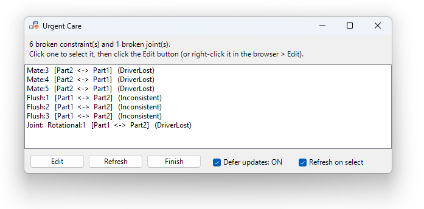

# Urgent Care

A small add-in for Autodesk Inventor that lists the broken ("sick") constraints and joints in an assembly in one window, lets you pick one to select and edit, and turns Defer Update on and off for you while you fix them.

**Works with Inventor 2025, 2026 and 2027** (Windows, 64-bit). Developed on 2025.4 and tested on 2025 and 2027. The add-in carries its own copy of the Inventor interop, so the same DLL runs on all three. Later versions have not been tested.

**Where to find it:** the add-in installs an **Urgent Care** button on the **Assemble** tab, **Relationships** panel, in the Assembly environment.

**Download and source code:** <https://github.com/CurtisWagu/Assembly_Constraint_Urgent_Care>



> **Provided as is. Not supported.** See [Disclaimer](#disclaimer).

## Contents

1. [What it does](#what-it-does)
2. [Install without Visual Studio](#install-without-visual-studio)
3. [Using the add-in](#using-the-add-in)
4. [Uninstall](#uninstall)
5. [Troubleshooting](#troubleshooting)
6. [Build and modify the source code](#build-and-modify-the-source-code)
7. [Disclaimer](#disclaimer)

## What it does

When an assembly has several broken constraints or joints, fixing one can make Inventor show its constraint warning again, even though the one you just fixed is fine and the problem is in the others. This add-in gives you one place to work through them.

- Adds an **Urgent Care** button to the **Relationships** panel on the **Assemble** tab, in the Assembly environment.


- Lists every broken constraint **and joint** in one window, with the two parts it joins and its status. Joints are marked with `Joint:` at the start of the line.
- Click one to select it in Inventor, then open Inventor's own **Edit Constraint** or **Edit Joint** command from the window.
- Turns **Defer Update** on automatically when more than one constraint or joint is broken, so Inventor does not re-solve after every fix. It turns it off again when you click **Finish**.
- Updates the list when you pick a different item (you can switch this off).
- The window stays open while you work, so you can rotate the model and use the browser as normal.

## Install without Visual Studio

You do not need Visual Studio or any developer tools. Inventor 2025 or newer already includes the .NET runtime the add-in needs.

### 1. Get the files

Download `Assembly_Constraint_Urgent_Care.bundle.zip` from this repository's [Releases page](https://github.com/CurtisWagu/Assembly_Constraint_Urgent_Care/releases). It contains one folder, `Assembly_Constraint_Urgent_Care.bundle`, laid out like this:

```
Assembly_Constraint_Urgent_Care.bundle
├── PackageContents.xml
└── Contents
    ├── Assembly_Constraint_Urgent_Care.dll                       <- the add-in itself
    ├── Autodesk.Assembly_Constraint_Urgent_Care.Inventor.addin   <- loads the DLL
    ├── Assembly_Constraint_Urgent_Care.X.manifest
    ├── Assembly_Constraint_Urgent_Care.deps.json
    ├── Assembly_Constraint_Urgent_Care.runtimeconfig.json
    ├── stdole.dll
    ├── Microsoft.VisualStudio.Interop.dll
    └── Microsoft.VisualStudio.Imaging.Interop.14.0.DesignTime.dll
```

Keep all of these files together. The `.dll` and the `.addin` file are the two that matter most. The others are support files the DLL needs.

### 2. Unblock the download (important)

Windows blocks files that came from the internet, and a blocked DLL will not load in Inventor.

1. Right-click `Assembly_Constraint_Urgent_Care.bundle.zip` and choose **Properties**.
2. At the bottom of the General tab, tick **Unblock**, then click **OK**.
3. Only then extract the zip.

If you already extracted it, unblock the zip and extract again.

### 3. Copy the folder to Inventor's plug-in location

Close Inventor first. Copy the whole `Assembly_Constraint_Urgent_Care.bundle` folder into **one** of these:

| Who can use it | Folder | Notes |
|---|---|---|
| Only you (recommended) | `%AppData%\Autodesk\ApplicationPlugins\` | Type this into the Windows Explorer address bar. Create the `ApplicationPlugins` folder if it does not exist. |
| Everyone on the PC | `C:\ProgramData\Autodesk\ApplicationPlugins\` | Needs administrator rights. |

This one location is read by Inventor 2025, 2026 and 2027, so you do not need a separate copy for each version.

When you are done, you should have this file:

```
%AppData%\Autodesk\ApplicationPlugins\Assembly_Constraint_Urgent_Care.bundle\Contents\Assembly_Constraint_Urgent_Care.dll
```

Do not copy only the `Contents` folder, and do not rename the `.bundle` folder's contents. Inventor finds the add-in through `PackageContents.xml`, so it must sit directly inside the `.bundle` folder.

### 4. Start Inventor

Open an assembly, click the **Assemble** tab, and look for the **Urgent Care** button at the end of the **Relationships** panel. If Inventor asks whether to trust or load the add-in, allow it.

## Using the add-in

Open an assembly and click **Urgent Care**. The window stays open while you work.

1. The window lists every broken constraint and joint. If there is more than one, **Defer updates** switches on.
2. Click an item in the list. It is selected in Inventor.
3. Click **Edit** to open Inventor's Edit Constraint (or Edit Joint) dialog for it. Fix it and click OK in that dialog.
4. Click the next item, and repeat. Click **Refresh** at any time to update the list.
5. Click **Finish** when you are done. This turns Defer Update off and updates the assembly once.

### Constraints and joints

Broken assembly constraints (Mate, Flush, Angle, Insert and so on) and broken assembly joints (Rigid, Rotational and so on) appear together in one list. A joint line starts with `Joint:`, and a constraint line starts with its name. The heading above the list counts both, for example "6 broken constraint(s) and 1 broken joint(s)." Both kinds are selected, edited and refreshed the same way, and both count toward switching **Defer updates** on. The part names shown are the component names from the Inventor browser.

| Control | What it does |
|---|---|
| **The list** | One line per broken constraint or joint: name, the two parts it joins, and its status. The window grows to show 5 to 10 lines, then scrolls. |
| **Edit** | Selects the item and runs Inventor's **Edit Constraint** or **Edit Joint** command. If that command is not available in your version, select the item in the list, then right-click it in the Inventor browser and choose **Edit**. |
| **Refresh** | Updates the assembly and rebuilds the list. Constraints and joints you have fixed drop off it. |
| **Finish** | Turns Defer Update **off**, updates the assembly once, and closes the window. Closing the window with the X does the same. |
| **Defer updates** | Shows whether Defer Update is on (black) or off (gray). It is switched on for you when more than one constraint or joint is broken, and you can tick or untick it yourself. Hover over it for a short explanation. |
| **Refresh on select** | When ticked, clicking a different item first updates the assembly and rebuilds the list. Untick it if that update brings back Inventor's constraint warning. |

Tips:

- Defer Update is normally **off** in Inventor (**Tools > Application Options > Assembly > Defer Update**). The add-in turns it on only while it is needed. **Finish always turns it off**, so if you normally keep it on, tick the option again yourself afterwards.
- The window belongs to the assembly that was active when you opened it. If you open it from a different assembly, the old window closes and a new one opens.
- Suppressed constraints and joints are not listed.

## Uninstall

1. Close Inventor.
2. Delete the `Assembly_Constraint_Urgent_Care.bundle` folder from the plug-in folder you used above.

To switch it off without deleting it, use **Tools > Add-Ins > Add-In Manager** in Inventor, select **Urgent Care**, and untick **Loaded/Unloaded** and **Load Automatically**.

## Troubleshooting

**There is no Urgent Care button.**
- Look at the end of the **Relationships** panel on the **Assemble** tab, with an assembly open. The button is not added for parts or drawings.
- Check the folder layout in step 3. `PackageContents.xml` must be directly inside `Assembly_Constraint_Urgent_Care.bundle`.
- Make sure you unblocked the zip before extracting (step 2). Right-click the `.dll`, choose **Properties**, and tick **Unblock** if you see it.
- Restart Inventor after copying the files.
- Open **Tools > Add-Ins > Add-In Manager** and look for **Urgent Care**. If it is listed but not loaded, tick **Loaded/Unloaded**.
- If a message says the Relationships panel was not found, Autodesk may have renamed or moved it in your version. See [Common changes](#common-changes).

**A message says to open an assembly.** The button only works when the active document is an assembly (`.iam`).

**The Edit button does nothing.** The window says what it tried. Select the item in the list, then right-click it in the Inventor browser and choose **Edit**. For joints the add-in runs the command `AssemblyJointEditComponentCmd`, which was confirmed on Inventor 2025.4 only. If Autodesk renames it in another version, use the right-click route.

**Inventor's constraint warning still appears.** Untick **Refresh on select** and use the **Refresh** button when you want to update the list. The add-in cannot always stop Inventor from showing the warning.

**The list is empty but a constraint looks wrong.** Click **Refresh**. The list shows constraints that Inventor reports as broken or out of date, so a constraint that is only unwanted will not appear.

**Two copies of the add-in.** If you also built from source, the build installs to the same plug-in folder. Keep only one copy of the bundle.

## Build and modify the source code

This section is for people who want to change the add-in for their own use.

### What you need

- Windows with **Autodesk Inventor 2025** installed. The project compiles against Inventor 2025's interop library, which also makes the same DLL work on newer versions (see [Compatibility](#keep-it-compatible-with-newer-inventor-versions)).
- **Visual Studio 2022 (17.14 or newer) or Visual Studio 2026** with the **.NET desktop development** workload. The solution uses the newer `.slnx` format.
- The **.NET 8 SDK** (installed with the workload above).

If you do not have Inventor 2025, change `InteropVersion` in `Assembly_Constraint_Urgent_Care.vbproj` to a version you do have.

### Build and run

1. Close Inventor.
2. Open `Assembly_Constraint_Urgent_Care.slnx` in Visual Studio.
3. Choose **Build > Build Solution**.
4. The build copies the add-in bundle to `%AppData%\Autodesk\ApplicationPlugins\Assembly_Constraint_Urgent_Care.bundle`. Start Inventor and the add-in loads.
5. To debug, press **F5**. Visual Studio starts the Inventor version named in `DebugInventorVersion` in the project file (2025 by default). Change that number to debug in a different version.
6. **Build > Clean Solution** removes the installed bundle again.

To make a copy for people without Visual Studio, run `Make-Release.ps1` (right-click it and choose **Run with PowerShell**). It builds the Release version without installing it, and writes `release\Assembly_Constraint_Urgent_Care.bundle.zip`, laid out as shown in [Get the files](#1-get-the-files). Attach that zip to a GitHub release.

### Project map

| File | What it is for |
|---|---|
| `StandardAddInServer.vb` | The add-in's entry point. Adds the **Urgent Care** button to the **Relationships** panel of the **Assemble** tab in the Assembly environment, and re-adds it if the ribbon is reset. |
| `Globals.vb` | The Inventor application reference and the add-in's GUID. |
| `Command Tools\UrgentCare\UrgentCareCommand.vb` | Creates the button and its icons. Runs when the button is clicked: opens the window, or brings it forward if it is already open. |
| `Command Tools\UrgentCare\UrgentCareForm.vb` | The window: the list, Defer Update handling, Edit, Refresh and Finish. Built in code, with no designer file. |
| `Utility Tools\IconLoader.vb`, `PictureConverter.vb` | Helpers: load one size from the icon file, and convert it for Inventor's API. |
| `Resources\ConstraintUrgentCare.ico` | The button and window icon, with 16 and 32 pixel images in one file. |
| `Autodesk.Assembly_Constraint_Urgent_Care.Inventor.addin` | The manifest Inventor reads to find and load the add-in. |
| `Assembly_Constraint_Urgent_Care.X.manifest` | Lets .NET register the add-in with COM without writing to the registry. |
| `PackageContents.xml` | Tells Inventor's plug-in loader where the `.addin` file is. |
| `Assembly_Constraint_Urgent_Care.vbproj` | The project file: target framework, Inventor versions, install location and the post-build copy. |
| `Make-Release.ps1` | Builds Release and zips the bundle for a GitHub release. |

### Common changes

- **Rename the button or change its tooltip:** edit `buttonLabel` and the tooltip text in `CreateButton` in `UrgentCareCommand.vb`.
- **Put the button on a different panel:** edit the `FindPanel(...)` call in `AddToUserInterface` in `StandardAddInServer.vb`. The tab and panel names are the ones shown in Inventor's ribbon.
- **Change the icon:** replace `Resources\ConstraintUrgentCare.ico`. Include at least 16 and 32 pixel images with transparency.
- **Change which Edit command runs:** see the `names` list in `OnEdit` in `UrgentCareForm.vb`.
- **Change how many rows show:** see `ResizeToRows` in `UrgentCareForm.vb` (5 to 10 by default).
- **Change which constraints and joints are listed:** see `Reload` in `UrgentCareForm.vb`. It lists every constraint and joint whose health status is not up to date and not suppressed.

### If you copy this into your own add-in

Give your add-in its own **GUID** so it does not clash with this one. Replace the GUID `365B2F23-E672-443B-96AC-252279713C68` everywhere it appears:

1. `Globals.vb` (the `_simpleAddInClientId` constant)
2. `Autodesk.Assembly_Constraint_Urgent_Care.Inventor.addin` (`ClassId` and `ClientId`)
3. `Assembly_Constraint_Urgent_Care.X.manifest` (`clsid`)
4. `PackageContents.xml` (`ProductCode`)

Also rename the assembly and files if you want both add-ins installed at once.

### Keep it compatible with newer Inventor versions

- The Inventor interop library is **embedded** in the add-in. That is why a build against Inventor 2025 also runs on 2026 and 2027.
- Autodesk sometimes renames or removes members. This add-in uses `AssemblyOptions.DeferUpdate`, `AssemblyConstraint.HealthStatus`, `AssemblyJoint.HealthStatus`, and the built-in command named `AssemblyEditConstraintCtxCmd`. That constraint command name was confirmed on Inventor 2025.4 and 2027. The joint edit command, `AssemblyJointEditComponentCmd`, was confirmed on Inventor 2025.4 only.
- Before using a new Inventor API member, look it up in the `Autodesk.Inventor.Interop.xml` file next to the interop DLL (in `C:\Program Files\Autodesk\Inventor <year>\Bin\Public Assemblies`) for the oldest **and** the newest version you want to support.
- The `.addin` file only loads in Inventor 2025 or newer, because older versions run on .NET Framework and cannot load a .NET 8 add-in.

### Visual Basic things to watch for

- Files that use `Imports Inventor` can clash with .NET names such as `Point`, `File`, `Path`, `Environment` and `Color`. Write `System.Drawing.Point`, `System.IO.File`, `System.IO.Path`, `System.Environment` and `System.Drawing.Color` in full.
- XML comments in the `.vbproj` cannot contain two hyphens in a row.

## Disclaimer

This software is provided **"as is"**, without warranty of any kind, express or implied, including but not limited to warranties of merchantability, fitness for a particular purpose and non-infringement. **It is not supported.** There is no guarantee of fixes, updates or answers to questions.

Use it at your own risk. Test it on copies of your data first. The authors are not liable for any damage, data loss or other problems that result from using it.

It was written for Inventor 2025, 2026 and 2027 and may stop working in other versions.

Autodesk and Inventor are registered trademarks of Autodesk, Inc. This project is not affiliated with, endorsed by or supported by Autodesk.
